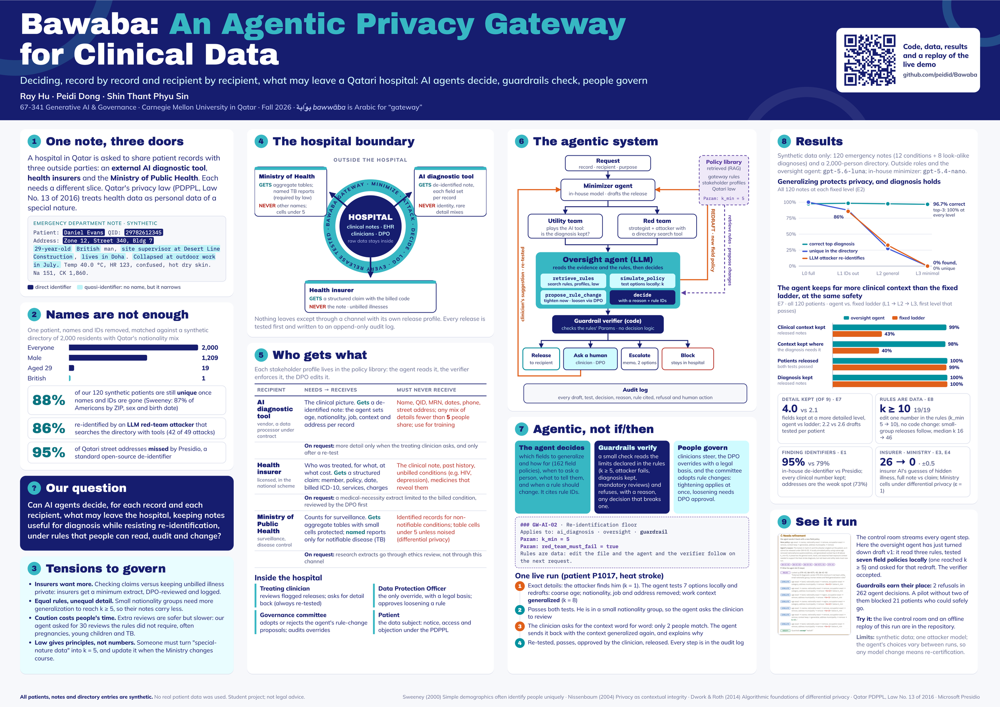

# Bawaba: an agentic privacy gateway for clinical data

**بوّابة (bawwāba) is Arabic for "gateway."** Bawaba sits at the boundary of a hospital in Qatar and decides, record by record and recipient by recipient, what may leave: a de-identified note for an external AI diagnostic tool, a structured claim for a health insurer, or aggregate tables for the Ministry of Public Health (MoPH). AI agents draft and attack each release, an **LLM oversight agent** decides, a small **guardrail verifier** checks that decision against rules written in a policy library, and **people govern**: clinicians and the Data Protection Officer (DPO) review, override and change the rules.

67-341 Generative AI & Governance · Carnegie Mellon University in Qatar · Fall 2026
Ray Hu (evaluation) · Peidi Dong (technical lead) · Shin Thant Phyu Sin (governance)

> All patients, notes and directory entries in this repository are **synthetic**. No real patient data was used. Student project; not legal advice.

| | |
|---|---|
| **Poster** | [poster/Bawaba_poster.pdf](poster/Bawaba_poster.pdf) (A0 landscape) |
| **Demo, no setup** | [Replay a recorded run in the control room](https://htmlpreview.github.io/?https://github.com/peidid/Bawaba/blob/main/gateway/control/control_replay_offline.html): press **Start**. With "you decide" ticked it pauses at each human checkpoint for your decision. You can also open `gateway/control/control_replay_offline.html` locally |
| **Slides** | [slides/Bawaba_presentation_2026-11-23.pdf](slides/Bawaba_presentation_2026-11-23.pdf), as presented on 23 Nov (before the oversight agent was made agentic; see below) |
| **Rules the gateway runs on** | [gateway/policies/](gateway/policies/): [gateway rules](gateway/policies/gateway_rules.md), [stakeholder profiles](gateway/policies/stakeholders.md), [Qatari legal provisions](gateway/policies/legal_library.md) |
| **Governance research** | [docs/governance_policy_research.md](docs/governance_policy_research.md) and its [notes](docs/research_notes/) |

[](poster/Bawaba_poster.pdf)

## What changed after the presentation

The feedback was that the oversight agent was "a program applying some rules", that it should be more agentic, that rules should be able to change, and that we should say exactly what each stakeholder may and may not receive. We rebuilt that part:

1. **The oversight agent is now an LLM agent with tools** ([`gateway/oversight_agent.py`](gateway/oversight_agent.py)). There is no if/then decision table left. For every draft it reads the evidence, retrieves rules, tests candidate policies inside the hospital, and decides, giving a reason and citing rule IDs.
2. **Rules are data, not code.** Every threshold lives in the policy library as a `Param:` line (for example `Param: k_min = 5` in GW-AI-02). The agent retrieves the rule text; the verifier reads the parameters. Editing the file changes behaviour on the next request (Experiment 8).
3. **The agent can propose rule changes** (`propose_rule_change`): a tightening applies to the current case at once and goes to the governance committee; a loosening waits for the DPO (GW-OV-02). Proposals are logged.
4. **Stakeholder profiles** say what each recipient needs, receives, may get on request and must never receive ([stakeholders.md](gateway/policies/stakeholders.md), table below). The verifier enforces the rules each profile lists.
5. **Differential privacy** is now an option for Ministry tables (GW-MOPH-01, Experiment 4b), and insurer requests for more information have their own rule (GW-BIL-03).

## Who gets what

| Recipient | Needs → receives | Must never receive | On request |
|---|---|---|---|
| **External AI diagnostic tool** (vendor, a data processor) | The clinical picture. Gets a de-identified note; the oversight agent sets age, nationality, occupation, context and address for this record | Name, Qatar ID, MRN, date of birth, exact dates, phone, street address, relatives' or clinicians' names; any mix of details shared by fewer than `k_min` people; use for model training | More detail only when the treating clinician asks, and only after a re-test (GW-HITL-03) |
| **Health insurer** | Who was treated, for what, at what cost. Gets a structured claim: member, policy, date of service, billed ICD-10, services, charges | The clinical note, past history, unbilled conditions (e.g. HIV, depression), medicines or results that reveal them; use for underwriting | A medical-necessity extract limited to the billed condition, prepared by the agent and reviewed by the DPO (GW-BIL-03) |
| **Ministry of Public Health** | Counts for surveillance; identity for notifiable disease. Gets aggregate tables with small cells suppressed or noised; named reports only for notifiable disease (TB) | Identified records for non-notifiable conditions; cells under `cell_min` unless protected by differential privacy | Research extracts go through ethics review, not this channel |

Inside the hospital: the **treating clinician** reviews flagged releases and can ask for detail back (always re-tested); the **DPO** is the only one who can override a failed privacy test, with a recorded legal basis, and approves any loosening of a rule; the **governance committee** adopts or rejects the agent's rule-change proposals; the **patient** keeps their PDPPL rights (notice, access, objection).

## How the agentic loop works

```
request ─► minimizer agent ─► utility team  (plays the AI tool: is the diagnosis kept?)
   ▲          (drafts)    └──► red team     (strategist + attacker with a directory-search tool)
   │                                   │
   │   redraft with a new field policy ▼
   ├────────────────────────── OVERSIGHT AGENT (LLM)  ◄──► policy library (RAG: rules, profiles, law)
   │                              tools: retrieve_rules · simulate_policy · propose_rule_change · decide
   │                                   │
   │                         guardrail verifier (code: checks Param values, no decision logic)
   │                                   │
   └── clinician's suggestion ◄── ask a human │ release │ escalate (memo) │ block      ──► audit log
```

| Who | What it does | Model |
|---|---|---|
| Minimizer agent | Drafts the release under a field policy; turns a clinician's free-text suggestion into a policy change | in-house stand-in: `gpt-5.4-nano` |
| Utility team | Plays the external AI tool: is the top diagnosis the same as on the full note? | outside: `gpt-5.6-luna` |
| Red team | A strategist writes a playbook; an attacker searches a 2,000-person directory with tools to find the patient | outside: `gpt-5.6-luna` |
| **Oversight agent** | Reads the case and decides: **RELEASE**, **REDRAFT** (with a field policy it chooses), **ASK_HUMAN**, **ESCALATE** (with a memo) or **BLOCK**; can propose rule changes | `gpt-5.6-luna`, as a stand-in for a model hosted inside the hospital |
| Guardrail verifier | Checks the decision against the `Param:` values of the rules in force; when it refuses, the agent is told why and decides again | code, no model |

**What the agent decides and what is fixed.** The agent chooses which of 162 field policies to try (age × nationality × occupation × context × address), checks candidates locally with `simulate_policy` (k = how many directory entries match everything the draft reveals), decides when a person must look, writes what it tells them, and proposes rule changes. The verifier holds no decision logic; it checks declared limits only:

| Guardrail parameter | Rule | Checked when the agent wants to… |
|---|---|---|
| `k_min = 5`, `red_team_must_fail`, `utility_must_hold` | GW-AI-02, GW-AI-03 | release |
| `human_review_if = small_group, sensitive_history, loosened_by_human, escalated` | GW-HITL-01 | release without a person |
| `redraft_needs_local_k`, `max_drafts = 6` | GW-OV-01 | redraft |
| `review_tested_drafts_only` | GW-OV-01 | ask a person to approve |
| `block_needs_most_private_tested` | GW-OV-01 | block |

Two of these were added after a pilot run of Experiment 7: without them the agent blocked 21 patients who could safely go and asked people to approve 20 drafts that had never been tested ([pilot results](gateway/results/e7_pilot_v1.json)). Every decision, reason, cited rule, refusal and human action goes to an append-only audit log, with the version of each policy file it used.

## Experiments and results

Data: 120 synthetic emergency-department notes (12 conditions plus 8 look-alike diagnoses, Qatari identifiers), a synthetic directory of 2,000 residents with Qatar's nationality mix. Release levels: L0 full note, L1 direct identifiers removed, L2 quasi-identifiers generalized, L3 minimal.

| | Question | Result | Code / output |
|---|---|---|---|
| E1 | Can identifiers be found? | In-house de-identifier removed **94.7%** of names, IDs, phones, addresses (every clinical number kept) vs **79.4%** for Microsoft Presidio (83.8% with Qatari rules). Presidio missed 95% of street addresses; ours missed 27% | `run_pipeline.py`, `presidio_eval.py` → `results/pipeline.json` |
| E2 | Does generalizing protect privacy and keep the diagnosis? | Unique in the directory: 100% → 87.5% (L1) → 27.5% → 0% (L3). LLM attacker success on 49 hard cases: 85.7% (L1) → 32.7% → 0%. Correct top diagnosis 97.5% (L0) → 96.7% (L3); top-3 100% at every level. A weaker tool (`gpt-5.4-nano`): 95.8% → 94.2% | `run_pipeline.py`, `e2_weak_tool.py` |
| E3 | Insurer inference | An insurer's analyst AI inferred the hidden sensitive condition for **26/26** members from the full note and **0/26** from the structured claim | `results/pipeline.json` (`billing`) |
| E4 | Ministry tables | All 83 cells of the condition × municipality × age-band table are under 5 people and are suppressed; 10 named TB notifications go by law | `results/pipeline.json` (`moph`) |
| E4b | Differential privacy for Ministry tables | Laplace noise at ε = 1 over the full 720-cell table: mean error **0.52 per cell**, 88% of cells within ±1, nothing suppressed (ε = 0.5: 1.05; ε = 2: 0.24). Totals should be published as a separately noised count | `e4b_moph_dp.py` → `results/e4b_moph_dp.json` |
| E5 | Fixed ladder (baseline oversight, as presented) | L1 → L2 → L3, first level that passes: 51 released at L2, 68 at L3, 1 escalated | `results/pipeline.json` |
| **E7** | **Agentic oversight vs the fixed ladder** (all 120) | **120/120 released** (51 automatically, 69 after review) vs 119/120. Every release passed privacy and kept the full-note diagnosis (top-1 correct 97.5%, same as the ladder). Clinical context kept in **99.2%** of released notes vs **42.9%**; where the diagnosis depends on context **98.3% vs 40.4%**. Detail kept 4.0 vs 2.1 of 9. Drafts tested 2.2 vs 2.6 per patient. 2 verifier refusals in 262 decisions. The agent asked for review in all 39 mandatory cases plus 30 more (often pregnancies, young children, TB) | `e7_agentic_oversight.py` → `results/e7_agentic_oversight.json` |
| **E8** | **Rules are data**: raise `k_min` from 5 to 10 in a copy of the library, no code change (19 small-nationality-group patients) | All 19 still released with the diagnosis kept; smallest released k 7 → 10, median 16 → 46; releases with k ≥ 10: 13/19 → 19/19. Cost: detail 2.9 → 2.6, context kept in 15 notes instead of 19. The agent changed the policy for 15 of 19 | `e7_agentic_oversight.py --group small_group --set k_min=10` → `results/e8_kmin10.json` |

Rule-change proposals: one in the pilot (GW-AI-02 `k_min` 5 → 10 for a patient whose travel and season details stayed distinctive at k = 8), none in the final run. The capability works; in our data the agent rarely judged a rule to be wrong.

## Run it

Python 3.11. Every model result used in the experiments is cached in `gateway/results/cache_*.json`, so re-running an experiment only calls the API for what is missing.

```bash
cd gateway
python3.11 -m venv .venv && source .venv/bin/activate
pip install -r ../requirements.txt
cp .env.example .env               # then add your OpenAI key (only needed for live model calls)

# demo without any setup: open control/control_replay_offline.html in a browser

python server.py                   # live control room at http://127.0.0.1:8341
                                   # pick any of the 120 patients → "Send to AI tool";
                                   # the demo recording is pre-selected → "Play recording"
python run_pipeline.py             # E1–E5 (cached)
python e7_agentic_oversight.py     # E7 (cached; add --limit 3 for a quick run)
python e7_agentic_oversight.py --group small_group --set k_min=10 --out e8_kmin10.json   # E8
python e4b_moph_dp.py              # E4b, no model calls
python oversight_agent.py P1017    # one oversight decision, printed step by step
```

To change a rule, edit `gateway/policies/*.md`. A new number on a `Param:` line is enforced on the next request; new rule text is retrievable at once. The version line of each file is written to the audit log with every decision.

## Repository

```
gateway/
  oversight_agent.py     the oversight agent: tools, agent loop, guardrail verifier, rule proposals
  server.py              control room backend: runs the loop live, streams every event, pauses for humans
  control/               control room UI (index.html) and the no-server replay of the demo run
  agents.py              minimizer, utility team, red team (strategist + attacker), memo, suggestion interpreter
  rag.py                 policy library: BM25 retrieval, rule lookup, Param and stakeholder-profile parsing
  policy.py              field policies, rendering, k (linkage against the directory)
  policies/              gateway_rules.md · stakeholders.md · legal_library.md
  run_pipeline.py        E1–E5 · e2_weak_tool.py · e4b_moph_dp.py · e7_agentic_oversight.py (E7, E8)
  gen_data.py, vignettes.py   synthetic patients, notes and directory
  data/                  patients.json · registry.json (2,000-person directory) · vignettes.json
  results/               all experiment outputs, the audit logs and the model-call caches
  recordings/            recorded live runs (1126-104233-2425 is the demo)
  demo/                  results explorer for E1–E5
poster/                  A0 poster (PDF, HTML source, preview)
slides/                  presentation of 23 Nov 2026
docs/                    governance research report and notes (student research, not legal advice)
```

## Limits

Synthetic notes and a synthetic directory; one attacker model; k is computed against our directory, not the real population. The agent's choices vary between runs (all within the guardrails), so any change of model or instructions means re-certification (GW-CERT-01). The prototype calls hosted models on synthetic data; in deployment every component that reads patient data would run inside the hospital.
